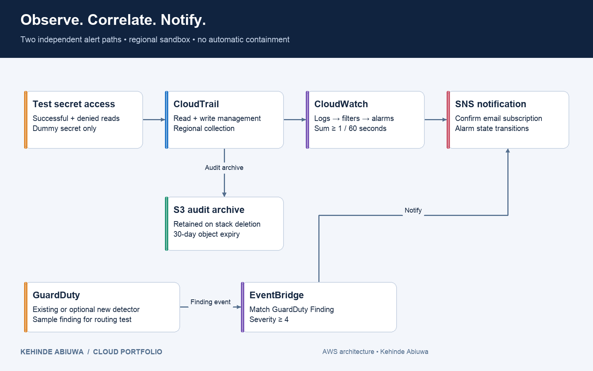

# AWS Security Observability

An AWS monitoring project that traces secret access from CloudTrail to CloudWatch alarms and SNS notifications, with a separate EventBridge path for GuardDuty findings. CloudFormation defines the infrastructure; test scripts exercise successful reads, denied reads and sample finding delivery.

**Architecture:** Secrets Manager → CloudTrail → CloudWatch → SNS · GuardDuty → EventBridge → SNS

**Author:** Kehinde Abiuwa | AWS Solutions Architect Professional | AZ-305  
[LinkedIn](https://www.linkedin.com/in/kehinde-abiuwa-b68087247) · [Article Series](#article-series) · [Deployment Guide](docs/deployment.md)

---

## Architecture



The system has two independent alert paths:

| Path | Trigger | Processing | Destination |
|---|---|---|---|
| Secret access | Successful or denied `GetSecretValue` request | CloudTrail → CloudWatch Logs → metric filter → alarm | SNS email on transition into ALARM |
| Threat finding | GuardDuty finding with severity ≥ 4 | EventBridge event-pattern match | SNS email containing the finding event |

CloudTrail also sends audit records to an S3 bucket. That bucket is retained when the stack is deleted, so teardown does not silently remove the audit archive.

**Scope:** a regional monitoring lab with investigation guidance. The baseline observes and notifies; it does not automatically revoke credentials, isolate instances or manage an organization-wide security platform.

---

## Services Used

| Service | Role |
|---|---|
| **AWS Secrets Manager** | Stores a generated dummy secret for controlled access tests |
| **AWS CloudTrail** | Records regional read and write management events |
| **Amazon CloudWatch Logs** | Stores audit events and applies metric filters |
| **Amazon CloudWatch Alarms** | Evaluates successful and denied secret-read counters |
| **Amazon SNS** | Delivers notifications to a confirmed email subscriber |
| **Amazon GuardDuty** | Supplies findings from an existing or stack-created detector |
| **Amazon EventBridge** | Routes GuardDuty findings with severity ≥ 4 to SNS |
| **Amazon S3** | Stores audit records with a 30-day object expiry rule |
| **AWS IAM** | Grants log-delivery permissions and provides a role for the denied-read test |
| **AWS CloudFormation** | Provisions the monitoring resources and manages their lifecycle |

---

## Key Design Decisions

### Capture Reads as Well as Writes

The trail uses `ReadWriteType: All`. Retrieving a secret is read activity, so a write-only trail would miss the requests being monitored. The filters cover `GetSecretValue` calls across the deployment region, not just the generated test secret.

### Separate Successful and Denied Access

A successful retrieval and an authorization failure have different meanings. Two filters publish separate metrics, making it easier to identify which event caused an alarm. The denied-read test uses a dedicated role with an explicit deny on the dummy secret.

### Count Events with Sum

Each matching event contributes `1`. The alarms use **Sum over 60 seconds**, a threshold of **≥ 1**, and one evaluation period. Missing data is treated as not breaching. Notifications follow alarm state transitions; another read while an alarm is already ALARM may not produce another email.

### Respect Existing GuardDuty Configuration

The deployment script checks for an existing regional detector. It can create one when requested, but does not take ownership of a detector that already exists outside this stack. Later deployments preserve a detector already owned by the stack.

### Retain the Audit Archive

CloudWatch logs have 14-day retention while the stack exists. The S3 audit bucket has a 30-day object expiry rule and remains after stack deletion. Its removal is a separate, deliberate cleanup step.

---

## Repository Structure

```text
aws-security-observability/
├── infrastructure/
│   └── security.json                # Complete CloudFormation stack
├── scripts/
│   ├── deploy.py                    # Deploy and check detector ownership
│   ├── test_security.py             # Read, denied, GuardDuty and status modes
│   ├── test_filters.py              # Check fixtures with AWS TestMetricFilter
│   ├── cleanup.py                   # Delete stack; report retained audit bucket
│   └── common.py                    # AWS CLI helpers
├── queries/
│   └── secret-access.logsinsights   # Identity, secret, source and outcome
├── diagrams/                        # Architecture, alert validation, investigation
│                                    # Each in Draw.io, SVG and PNG formats
├── screenshots/study-notes/          # Four original AWS exercise screenshots
├── docs/
│   ├── articles/
│   │   ├── github/                  # Four walkthroughs with relative links
│   │   └── devto/                   # Four unpublished Dev.to drafts
│   ├── deployment.md
│   ├── troubleshooting.md
│   ├── runbook.md
│   ├── cleanup.md
│   ├── source-map.md
│   ├── publishing.md
│   └── validation.md
├── tests/
│   ├── fixtures/                    # Synthetic successful and denied events
│   ├── test_safety.py
│   └── test_command_results.py
├── evidence/                        # Capture results from a fresh deployment
└── .github/workflows/validate.yml    # Template linting and regression checks
```

---

## Deploy the Full Stack

**Prerequisites:** AWS CLI v2, Python 3.9+, a configured sandbox profile, an email address you can confirm, and permissions for the resources above. The [deployment guide](docs/deployment.md) covers deployment and test permissions, including `sts:AssumeRole` for the denied-read test. Run commands from the repository root.

### 1. Select the account and inspect GuardDuty

```bash
export AWS_PROFILE=your-sandbox-profile
export AWS_DEFAULT_REGION=eu-west-2
aws sts get-caller-identity
aws guardduty list-detectors --region "$AWS_DEFAULT_REGION"
```

### 2. Deploy with CloudFormation

When GuardDuty already has a detector in this region:

```bash
python3 scripts/deploy.py   --region "$AWS_DEFAULT_REGION"   --email you@example.com
```

If no detector exists and you want this stack to create one, add `--create-detector` to that command. Without a detector, the secret-access path can still operate, but there will be no GuardDuty findings to route.

The default stack is `security-monitoring-lab`. The script deploys `infrastructure/security.json` and uses `CAPABILITY_IAM` for its roles. All lifecycle scripts accept `--stack` for an alternative name.

### 3. Confirm the SNS subscription and inspect outputs

Open the SNS confirmation email and confirm the subscription before testing notifications. Stack creation can complete while the subscription is still pending.

```bash
aws cloudformation describe-stacks   --stack-name security-monitoring-lab   --query 'Stacks[0].Outputs'   --output table
```

Outputs include `SecretArn`, `AuditLogGroup`, `TopicArn`, both alarm names, `DeniedTestRoleArn`, `FindingRuleName` and `AuditBucketName`. `DetectorId` is included when the detector belongs to this stack.

### 4. Test successful and denied secret reads

```bash
python3 scripts/test_security.py read --region "$AWS_DEFAULT_REGION"
python3 scripts/test_security.py denied --region "$AWS_DEFAULT_REGION"
python3 scripts/test_security.py status --region "$AWS_DEFAULT_REGION"
```

The read test suppresses the secret value. The denied test assumes the dedicated test role using temporary credentials and verifies an `AccessDenied` response. A failed role assumption is a separate error, not a successful denied-read test.

Allow time for CloudTrail delivery, then inspect the log event, metric, alarm history and notification. Use `queries/secret-access.logsinsights` to find the identity, source address, secret identifier and outcome.


*The alarm result from my original console exercise. The walkthrough explains the metric and notification troubleshooting that led to it.*

[Read the alarm troubleshooting article](docs/articles/github/02-cloudwatch-alerts.md) · [View all four exercise screenshots](screenshots/study-notes/README.md)

### 5. Test GuardDuty finding delivery

```bash
python3 scripts/test_security.py guardduty --region "$AWS_DEFAULT_REGION"
```

The script requests a sample `Backdoor:EC2/DenialOfService.Tcp` finding. Verify the **[SAMPLE]** label, EventBridge invocation and SNS notification. This tests event routing, not detection of a new attack.

| Test | Expected observation |
|---|---|
| Successful secret read | Matching audit event and successful-read metric |
| Explicitly denied read | AccessDenied event and denied-read metric |
| Alarm evaluation | Transition into ALARM and notification to the confirmed subscriber |
| GuardDuty sample | Finding matches the severity filter and reaches SNS |

The optional `scripts/test_filters.py --region "$AWS_DEFAULT_REGION"` command checks synthetic fixtures through AWS's read-only `TestMetricFilter` API. It requires credentials and API permission, but creates no resources.

---

## Security and Investigation

### Secret and Identity Handling

- The template generates a dummy secret; no secret value is stored in the repository.
- Test scripts do not print secret values or temporary credentials.
- The denied-test role explicitly denies reading the generated secret.
- The trail has a dedicated log-delivery role; the audit bucket policy identifies the trail allowed to write to it.

### Audit Storage and Notifications

- S3 Block Public Access is enabled and audit objects use SSE-S3 encryption.
- The trail enables log-file validation and records regional read/write management events.
- SNS permits EventBridge publication to the lab topic; the CloudWatch grant is restricted to this account and the two alarms.
- Email notification latency includes collection, delivery and evaluation time. A 60-second alarm period is not a 60-second end-to-end guarantee.

### Response Workflow

Use the [investigation runbook](docs/runbook.md) to identify the alert path, inspect the caller or affected resource, correlate the activity and record a conclusion. A successful read may be authorized; an AccessDenied event does not prove data exposure. Keep sample findings classified as tests.

[Notification troubleshooting](docs/troubleshooting.md) covers missing events, filters, alarm state and SNS delivery.

---

## Validation

CloudFormation linting and five regression tests passed locally. The included screenshots document the earlier console exercises.

```bash
python3 -m pip install -r requirements-dev.txt
cfn-lint infrastructure/security.json
python3 -m unittest discover -s tests -v
```

[Validation record](docs/validation.md) · [Evidence checklist](evidence/README.md)

---

## Costs and Teardown

Budget for Secrets Manager, CloudTrail where applicable, CloudWatch logs and alarms, S3, SNS and GuardDuty if enabled. An additional trail can duplicate collection charges. See [cost and retention details](docs/cleanup.md).

Export needed evidence, then run:

```bash
python3 scripts/cleanup.py   --region "$AWS_DEFAULT_REGION"   --confirm-stack security-monitoring-lab
```

The script deletes the stack and prints the **retained audit bucket** name. Follow the cleanup guide to review and deliberately remove that bucket. The stack's log group and dummy secret are deleted; a stack-owned detector is removed, while a pre-existing detector stays enabled.

---

## Article Series

Four walkthroughs cover audit collection, alert troubleshooting, finding routing and investigation. Both publication versions are included; Dev.to files remain drafts.

| Part | Article | GitHub | Dev.to |
|---|---|---|---|
| 1 | Tracking Secret Access on AWS with Secrets Manager and CloudTrail | [Read](docs/articles/github/01-secret-audit.md) | [Draft](docs/articles/devto/01-secret-audit.devto.md) |
| 2 | Why My Secret-Access Alert Was Not Firing: CloudWatch and SNS | [Read](docs/articles/github/02-cloudwatch-alerts.md) | [Draft](docs/articles/devto/02-cloudwatch-alerts.devto.md) |
| 3 | From a GuardDuty Finding to an SNS Notification with EventBridge | [Read](docs/articles/github/03-guardduty-events.md) | [Draft](docs/articles/devto/03-guardduty-events.devto.md) |
| 4 | Investigating AWS Security Alerts and Preserving the Evidence | [Read](docs/articles/github/04-investigation-evidence.md) | [Draft](docs/articles/devto/04-investigation-evidence.devto.md) |

---

## Skills Demonstrated

- **Cloud security** — secret-access auditing, scoped test roles and GuardDuty finding analysis.
- **Observability** — CloudTrail, Logs Insights, metric filters and CloudWatch alarms.
- **Event-driven integration** — EventBridge patterns and SNS notification delivery.
- **Troubleshooting** — tracing missing notifications across collection, evaluation and delivery.
- **Infrastructure as Code** — CloudFormation, automated test events and explicit resource ownership.
- **Incident investigation** — correlating identities and resources, preserving evidence and documenting outcomes.

---

## Author

**Kehinde Abiuwa** — AWS Certified Solutions Architect (Professional) | Microsoft AZ-305

[LinkedIn](https://www.linkedin.com/in/kehinde-abiuwa-b68087247) · [Dev.to](https://dev.to/kehindeabiuwadotcom)  
Email: abiuwakehinde96@outlook.com · Open to Solutions Architect roles (remote/hybrid)

## License

Code and original documentation are available under the [MIT License](LICENSE). Referenced study materials and third-party branding retain their respective owners’ rights.
