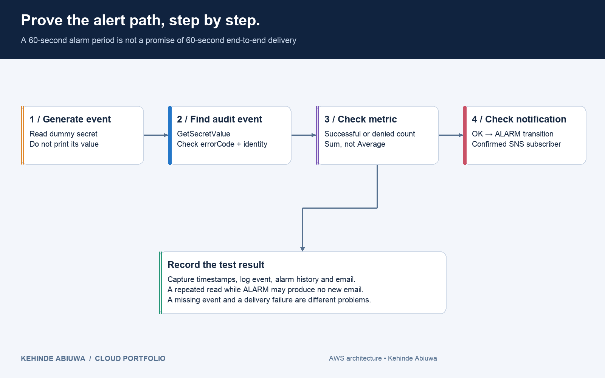

# Alert delivery troubleshooting

| Symptom | Check |
|---|---|
| No CloudTrail event | Correct account/region, trail IsLogging, read-management collection, fresh event |
| Event history has event; log group does not | Trail log role, delivery errors, log-group ARN and ingestion delay |
| Event in logs, metric missing | EventSource/eventName/errorCode, correct filter/log group; filters only process new events |
| Metric present, no ALARM | Sum, threshold >= 1, period, datapoint time and missing-data behavior |
| Alarm ALARM, no new email | Did it change state? Subscription confirmed? Correct topic and SNS policy? |
| Sample finding but no notification | Severity >= 4, same region, enabled rule, failed-invocation metrics and SNS policy |
| Denied-test script fails early | Operator needs sts:AssumeRole; assume-role failure does not test GetSecretValue |

Use `python3 scripts/test_security.py status --region eu-west-2` and `queries/secret-access.logsinsights`. Never print the secret value merely to prove access.

The notes contain a useful correction: one section calls secret retrieval write activity; the later event evidence says readOnly true. This implementation explicitly collects reads. It also avoids promising one email per request: a CloudWatch alarm is stateful.
