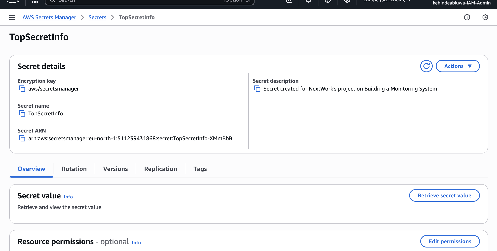
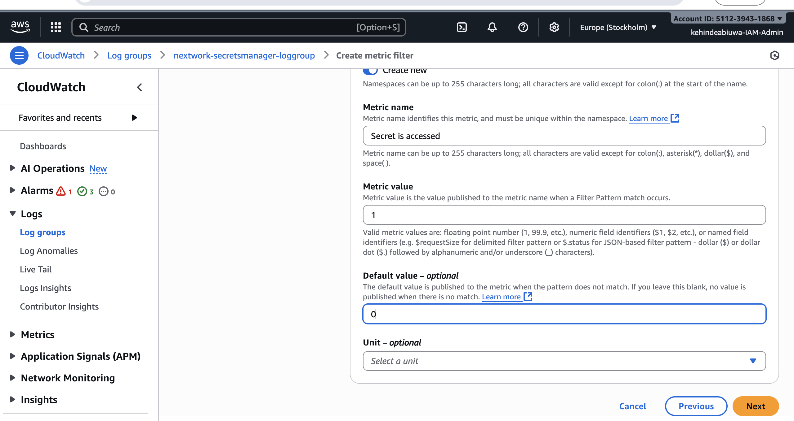
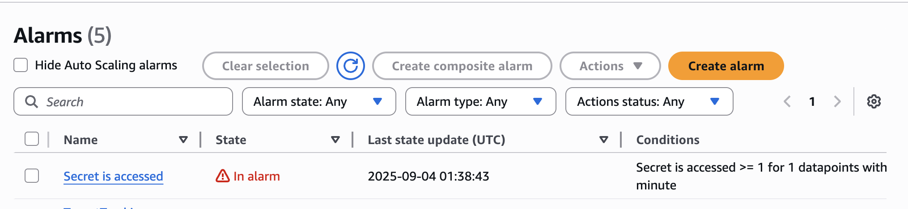
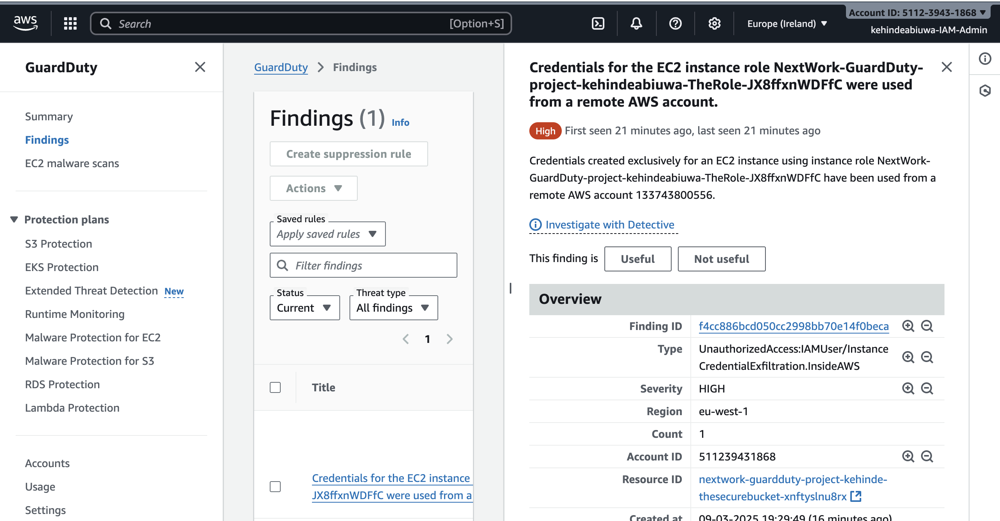

# Screenshots from the original study notes

Selected AWS console and terminal screenshots extracted from the embedded images in Kehinde Abiuwa's study PDFs. Original pixels and resolution are preserved; these are not generated recreations. They document the earlier exercises, not deployment of this repository. Historical resource names, account identifiers, addresses and regions may remain visible. Screens displaying credential values, secret values or personal email details were excluded.

## Secrets manager details

Original study exercise: the Secrets Manager details page shows the test secret and its encryption key, with the secret value still hidden. The new template generates a separate dummy secret.

[Source PDF, page 3](https://github.com/kehindeabiuwa-dotcom/cloud-portfolio/blob/main/STORAGE%2C%20Web%20Hosting%20%26%20SECURITY/Build%20a%20Security%20Monitoring%20System.pdf#page=3) · [GitHub article](../../docs/articles/github/01-secret-audit.md)

## Metric filter value

Original study exercise: the metric-filter form publishes 1 for a match and uses a default of 0. The new template implements separate counters for successful and denied reads.

[Source PDF, page 7](https://github.com/kehindeabiuwa-dotcom/cloud-portfolio/blob/main/STORAGE%2C%20Web%20Hosting%20%26%20SECURITY/Build%20a%20Security%20Monitoring%20System.pdf#page=7) · [GitHub article](../../docs/articles/github/02-cloudwatch-alerts.md)

## Secret access alarm

Original study exercise: the secret-access alarm is in ALARM. The capture shows the alarm triggered during my console exercise.

[Source PDF, page 1](https://github.com/kehindeabiuwa-dotcom/cloud-portfolio/blob/main/STORAGE%2C%20Web%20Hosting%20%26%20SECURITY/Build%20a%20Security%20Monitoring%20System.pdf#page=1) · [GitHub article](../../docs/articles/github/02-cloudwatch-alerts.md)

## Guardduty finding details

Original threat-detection exercise: a high-severity instance-credential-exfiltration finding. This came from the earlier controlled exercise, not the new sample-finding test, and does not demonstrate EventBridge/SNS delivery for this repository.

[Source PDF, page 13](https://github.com/kehindeabiuwa-dotcom/cloud-portfolio/blob/main/STORAGE%2C%20Web%20Hosting%20%26%20SECURITY/Threat%20Detection%20with%20GuardDuty.pdf#page=13) · [GitHub article](../../docs/articles/github/03-guardduty-events.md)
